# ConnectOnion for Android — User Guide

This is the guide for using the app. For installing it see
[`INSTALL.md`](INSTALL.md); for how it is built see [`README.md`](README.md).

ConnectOnion lets you talk to AI agents that run somewhere else — on a
developer's laptop, on a server, on someone's Raspberry Pi — from your phone.
There is no account to create. The app makes an identity for you on first
launch and keeps it on the device.

---

## 1. Connecting to an agent

On first launch you land on **Setup**. It scans the default relay and lists the
agents currently online.

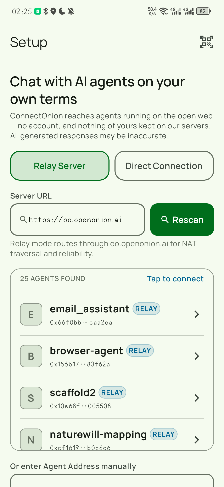

**The quickest way in is to tap one.** The list is live; agents come and go as
their owners start and stop them.

If you were given an address instead, scroll to **Or enter Agent Address
manually** and paste it. An address is `0x` followed by 64 hex characters.

**Or scan a QR code.** The QR button in the top right opens the camera. It reads
the code behind the **Share** button on chat.openonion.ai, a code that holds just
the address, `connectonion://agent/0x…`, and `https://your-server/0x…` for an
agent on a server of its own. A code it understands connects straight away:
there is nothing to tap. Any other QR code is refused with a message above the
Connect button, and the form stays as it was. The camera only reads the code:
nothing is recorded or uploaded. To make a code for your own agent, put its
address into any QR generator.

**Relay Server or Direct Connection.** Leave it on *Relay Server* unless you
were told otherwise — the relay handles agents behind home routers, which is
most of them. *Direct Connection* is for an agent you can reach on the network
yourself, and it asks for that agent's own URL instead of the relay's.

### If the agent asks for an invite code

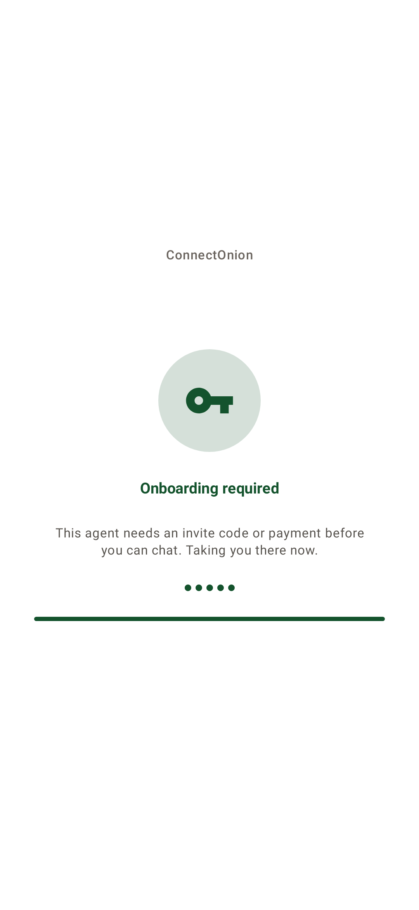

Some agents are not open to everyone. The connecting screen says so for a
moment, then takes you to the chat, where a card asks for the code you were
given. Enter it and tap **Redeem code**. Nothing is charged without asking you
first.

---

## 2. Having a conversation

Type in the box at the bottom and send. The agent's reply arrives in the
transcript as plain text, and under each reply is a line like:

> ⧉ 2:10 PM · 25.3k tokens · $0.015

That is when the reply arrived, how much of the agent's context the whole
exchange used, and what it cost. The agent's owner pays this, not you, unless
you have supplied your own key. Tap the copy icon at the start of the line to
copy the reply.

**While the agent is working** you can see what it is doing: a line such as
**Working… 12s · step 5** sits above its newest steps (what it is thinking, the
commands it runs, the files it reads), with older steps folded behind
**N earlier steps**. The send button becomes a round **Stop** button. Stop is a
request, not a kill switch: the agent finishes the step it is on and sends a
closing message, so expect one more line after you press it.

**Once it is done, only the answer stays in view.** The steps fold into one
line above it, such as **Worked for 16s · 7 steps**, with a red **1 failed**
badge if any step failed. Tap that line to see every step again, and tap a step
to see the whole command or thought and what it produced; the line stays open
for as long as you stay in the chat. Earlier conversations open with their
steps folded. A turn that ended without an answer, because it failed or you
stopped it, keeps its steps open so you can see where it got to, and a question
or an approval waiting for you is never folded away.

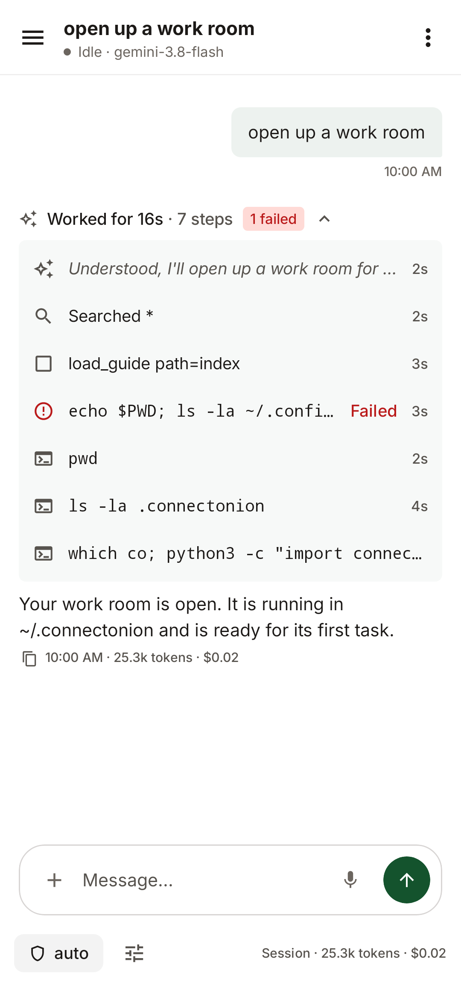

**You do not have to wait.** Keep typing while a reply is still coming: the box
says **Queue a follow-up…**, and once you have typed something a send button
appears beside Stop.

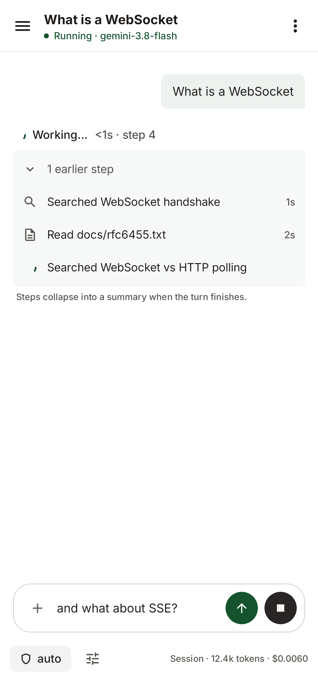

A message typed mid-answer waits for the current turn and goes out when it
ends, so nothing is lost and nothing interrupts.

**Safe to show.** Passwords, keys and tokens in anything the agent sends (its
replies, the commands and files it asks to use, their output, its Todo List and
its Home page) show as
`[redacted]`, and the owner's home folder shows as `~`, so a screenshot of the
chat is safe to share. Your own messages are shown the same way: a key you
pasted reads `[redacted]` in your bubble, but the agent got it as you typed it,
and Retry sends it again as typed. Code that only reads a secret, such as
`token = await getToken()`, is left as written. Other locations on the agent's computer stay visible in
the chat, because when the agent asks to change `/var/www/site` you need to see
that before you approve it. Notifications, error messages, conversation titles
and the Logs screen show no locations at all: they read `[path removed]`. The
agent still gets exactly what it sent: approving a plan or tapping an answer
sends the original. An error the agent could only describe as raw technical
output reads *The agent reported an error*; the details are in its logs on its
computer.

---

## 3. Slash commands

Some agents publish named skills. Type `/` to see them.

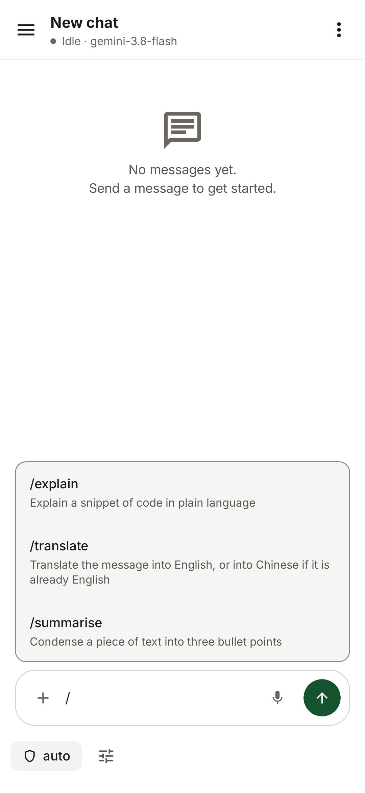

Each entry shows the description the agent gave it, so you do not have to guess
what a command does or how it is spelled. A skill the agent did not describe
shows its name alone. **An empty palette is not a fault** —
it means this agent publishes no skills, which many do not, or that it has not
let you in yet. Skills only appear once you are in, for example after entering
an invite code. The agent's Edit screen lists them under **What this agent can
do**.

---

## 4. Speaking instead of typing

Tap the microphone and talk. What you said lands **in the text box** rather than
being sent.

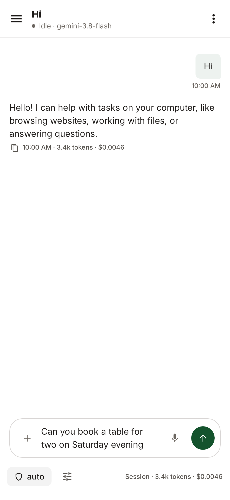

Nothing is sent until you press send, so you can fix a misheard word first.

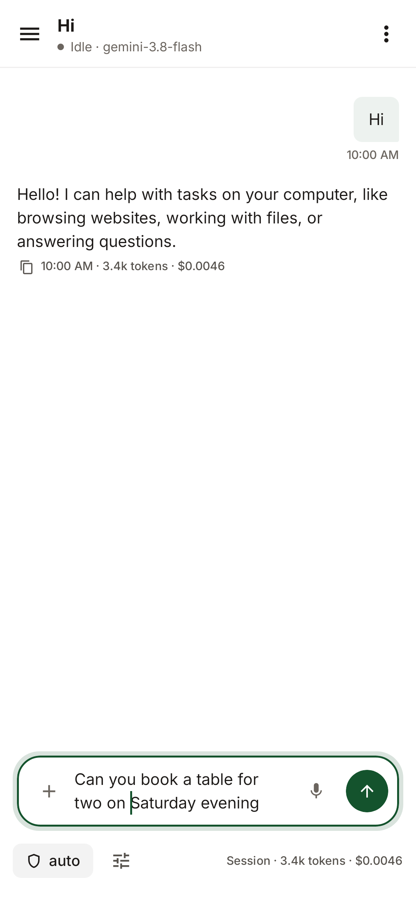

The first dictation on a phone may pause a second or two on **Preparing…**
while the app works out whether the phone's own speech recogniser can be used.
If it cannot, the app records and has the audio transcribed instead — you get
the same editable text, just only once you stop talking rather than as you
speak. Either way the audio is not stored and not sent anywhere else. A
recording under a second, usually an accidental tap, is dropped with
"Recording too short. Try again."

> On an emulator, dictation is not worth judging: the microphone is the host
> machine's and what the emulator reports about it does not match a phone.

---

## 5. Attaching a photo or a file

The **+** at the left of the composer offers the camera, your gallery and a file
picker. Up to three attachments per message. Images are compressed on the device
before they are sent.

---

## 5a. An agent's own Home page

Some agents send the app a page of their own — a status board, a form, a set of
shortcuts, whatever their author built. When one does, a tab named **Dashboard**
or, for a Control Center, **Control Center** appears next to **Chat** at the top of
the screen; tap it to open the page, and tap **Chat** or use back to return to the
conversation.

The page is the agent's, not the app's, so what it contains is up to whoever
wrote the agent. It is displayed in a locked-down view: it cannot reach the
network, cannot store anything, and cannot navigate anywhere. If there is neither
a tab nor an icon, this agent has not sent one.

Some agents publish a full **Control Center** instead: a reviewed web app that
can show live information and act for you. The same tab opens it. Anything it
does for you, such as sending a message or running a skill, appears in the chat
as a message from you, so you can always see it. It cannot use your camera,
microphone or location, read your clipboard, or open other sites. Going back to
the chat while it is working leaves the work running. If it stops unexpectedly,
the screen says so; tap **Reload** to start it again.

Switching between the tabs loses nothing: the chat keeps what you had typed and
how far you had scrolled, and the page keeps whatever it was showing. The
keyboard closes when you switch. Running a skill from the page's tab sends its
message and takes you to the Chat tab, where the turn it started is.

On a tablet, or a foldable that is open, the page does not get a tab: it sits
beside the chat, so you can use both at once. The tabs and the back arrow are not
shown then, because the page is already open. Running a skill from the page sends
its message and leaves the page where it is. Fold the device and the page goes
back to its tab, and whatever you had typed in the chat is still there. A phone,
even turned on its side, uses the tabs.

A device that cannot show a Control Center app has no tab for it. A grid icon in
the chat's top bar opens a screen that says so.

The page is only open while the chat is. Go from the chat to Settings, Logs or the
agent list and it is closed; when you come back it is loaded again from the start.
A Control Center app starts afresh too, so whatever you had open or half-filled in
it is gone, though anything it already did shows in the chat as before.

Changing the theme does the same. When the page is open and the theme changes, whether
you change it or your phone does (a scheduled switch to dark at sunset, with the app
following the system), the page is loaded again in the new theme and a Control Center
app starts afresh.

## 5b. Your agent's Rem notebook

If you own the agent, it keeps a notebook called **Rem** about your people,
projects and tools. Open it from the chat's **⋮** menu, then **Rem**. Pages are
grouped by kind (People, Projects and so on); tap one to read it. A link to
another person or project opens that page. On a tablet the list and the page sit
side by side.

Rem is read-only here, and only the agent's owner can open it. Anyone else sees
**Only the owner can read this Rem**, with the command the owner would run on
the agent's computer to add you. Other messages tell you when the agent has no
notebook yet (`co rem init` creates one), when it is too large to open on a
phone, or when the agent did not answer. **Try again** appears only where
reading again could help.

Passwords, keys and tokens in a page show as `[redacted]`. Locations on the
owner's computer show as `[path removed]`, or as `~` for their home folder, and
the notebook's own location is never shown.

## 5c. Work Rooms: Claude Code and Codex

An agent that can use Claude Code or Codex may hand a coding task to one of
them. When it does, the chat shows a card for that run instead of a tool call:
which coding agent, the task, and whether it is working, waiting for your
decision, completed, failed or stopped. A run that finished while your phone
was not connected says **Ended**, since its result never reached this device. Tap **Open Work Room** to follow it: the
room lists each step the coding agent takes, such as updating files or running
tests, with the files it changed, and says how the run ended. It keeps updating
while you watch. You only see the steps the agent's Host describes, never the
raw commands it ran.

The room also shows the conversation with the coding agent, your messages and its
replies, under **Conversation**, with any code in a reply set in a fixed-width
font. Under the task, **Latest view** is the most recent picture of its workspace
or browser, when the agent's Host has sent one. A long run keeps only its most
recent part of the conversation. Passwords and keys are hidden, as elsewhere in
the app, and a reply that is nothing but the coding agent's raw output is replaced
by a note that the details are in the agent's logs.

To steer the run, type into the field at the bottom of the room and tap Send.
The message goes to the coding agent itself, not to the agent that started it.
It leaves the field only once the coding agent has taken it; until then the
field is locked and Send shows a spinner. If it is refused, or no answer comes
within a minute, your text stays where it is with the reason above it, so you
can send it again. Each room keeps its own draft, even if you go back to the
chat. Codex takes a message while it works, and a finished run of either can
be resumed with one. Claude Code takes a message only once its run has ended.

When the coding agent needs your permission, for example to change files or
run tests, the run says it is waiting for your decision and a request appears
at the top of its room (and in the chat). It says what the agent wants to do,
why, and which files. Tap **Allow once**, or **Deny**. Some requests also offer
**Allow for this session**. A request that would reach outside this Work Room,
or whose reach the Host could not check, shows only **Deny**: the Host would
refuse it even if you allowed it. A request still waiting when the connection
drops is still there when it comes back.

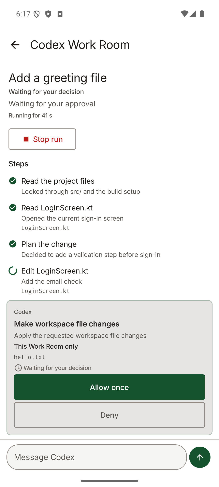 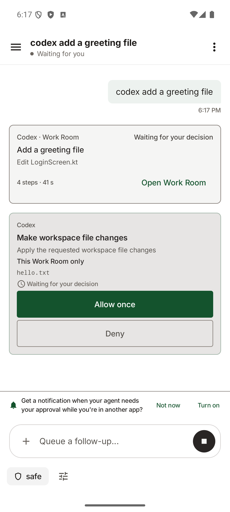 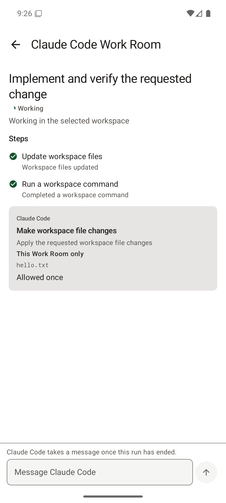

---

## 6. Deciding what the agent may do

Agents that can edit files or run commands ask permission first. The chip at the
bottom left sets how often they have to ask:

| Mode | What it means |
|---|---|
| **Safe** | Ask before file edits and commands. The default, and the one to stay on. |
| **Plan** | The agent works out what it would do and shows you, without doing it. |
| **Accept edits** | Edit files without asking. Commands still ask. |
| **Ultra work** | Fully autonomous, for a set number of turns that you choose. |

**Ultra work is fenced off deliberately** — it carries a warning and a turn
budget, and the app drops back to Safe when the budget runs out. Use it when you
are watching, not when you are away.

Agents on a newer host offer a different set, and the chip shows only what the
agent offers:

| Mode | What it means |
|---|---|
| **Read only** | Ask before anything that changes files or runs commands. |
| **Auto** | Run routine edits and commands; ask before risky ones. The default. |
| **Full access** | Fully autonomous, for a number of turns the agent's host sets. The app asks you to confirm before turning it on. The chip shows how many are left, and drops back to Auto when they run out. |

On these agents the mode can't be changed while the agent is working; the chip
waits until the turn finishes.

The line under the agent's name in the top bar says what it is doing:
**Running**, **Waiting for you** (a card needs your answer), **Idle**, or
**Session not found** (after a dropped connection, the agent said it no longer
holds this conversation's live session).

When a permission card appears you can **Allow once**, **Trust for this
session**, **Reject**, or ask the agent to **Explain** what it is about to do.

---

## 7. Conversations

Open the drawer with the ☰ button. Every agent you have used has its own list of
chats under it.

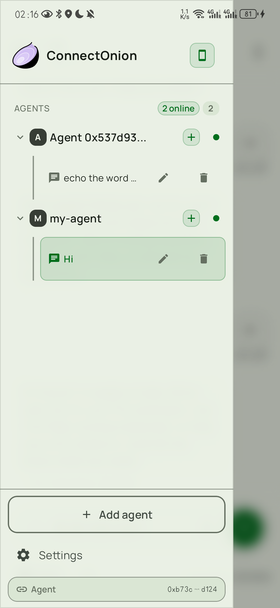

- **+** beside an agent starts a new chat with it.
- Tap a chat to reopen it. History is kept on the device and survives the app
  being closed or killed.
- The **pencil** renames a chat.
- The **bin** deletes one, after asking.

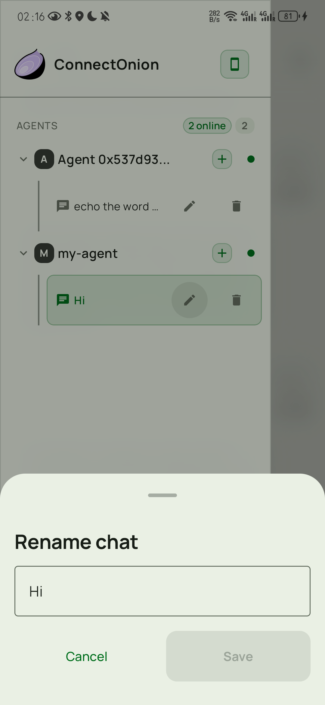

Renaming is worth doing once a list of chats stops being distinguishable by its
opening line.

---

## 8. Managing agents

**Settings → Agent List** holds the agents you have saved.

- **Add** one by address, or find one with **Discover**.
- **Drag** the handle to reorder.
- The **⋮** menu on each row sets it as default, edits it, or removes it.
- The default agent is the one the app opens on.

Editing an agent asks for a name, a server URL and the agent's address. An
address that is not `0x` plus 64 hex characters is rejected with a message
rather than saved.

---

## 9. Being told about a reply or an approval while you are elsewhere

**Settings → Notifications**, off by default. With it on, a reply that arrives
while you are in another app posts a notification; tapping it brings you back.

An approval the agent is waiting on posts one too, so the agent is not left
stopped while you are away. It says which agent and what it wants to do, and
tapping it opens that conversation, or the Work Room when a Claude Code or
Codex run is the one asking. On a locked phone it only says that an approval is
waiting. Each approval has its own notification, and it goes away once you
answer it, the turn ends (another device may have answered), or you open that
chat. Approvals have their own channel, **Approval requests**, which interrupts
where a reply only waits in the shade; Android's settings for the app can
silence either one alone.

The first time an approval is on screen while notifications are off, the chat
offers to turn them on, and asks for Android's permission only then. It offers
once: **Not now**, or refusing Android's dialog, leaves Settings as the way to
turn them on later.

There is a real limit worth knowing, for replies and approvals alike. The app
can only notice either while it still holds its connection, and it has no
background service to keep that connection: once you swipe it away, or Android
closes it to save battery (on some phones within seconds of leaving it), no
notification comes until you open it again. So this covers stepping away mid-answer, not
closing the app and coming back an hour later. The sound is
Android's own, on the app's notification channel, which the same Settings row
opens.

---

## 10. Settings

| | |
|---|---|
| **Appearance** | Light, dark, or follow the system. It applies to an agent's Home page too: a page written without a dark style is darkened automatically, so it can look a little different from the app's own colours. |
| **Show live progress** | Whether thinking and tool steps appear as they happen, or only the finished reply. |
| **Render Markdown** | Formatted replies, or plain text. |
| **Font size** | Four steps — Small, Medium, Large, Extra Large — previewed live. Combines with the system font size rather than overriding it. |
| **Haptic feedback** | The small vibration when a message is sent. |
| **Sound effects** | The in-app tones for sending and receiving. Separate from notifications. |
| **Memory** | Whether an agent sees context carried over from your other chats with it. When off, each chat you open starts a new session on the agent. |
| **Custom instructions** | Text quietly prepended to everything you send — a standing "answer briefly", say. |
| **Push notifications** | Section 9. |
| **Notification sound** | Opens Android's own settings for this app's notification channel, where the full system sound list lives. |
| **Agent List** | Section 8. |
| **Logs** | The app's own log, for reporting a problem. |
| **Delete all conversations** | Exactly that, for every agent. It asks first. |
| **Clear connection data** | Forgets the saved server and agent so the app starts from Setup again. Your conversations are kept — this is not the same as the row above. |
| **Terms & Privacy**, **Version** | Under About. |

**Account** is also here: your wallet address, a **recovery phrase** you can
write down, **Import Key** to restore an identity onto a new phone, and **Reset
Identity**, which discards the current one. Without the recovery phrase a reset
or a wiped phone means a new identity and no way back to the old one.

The phrase gives the same identity in the ConnectOnion CLI (`co auth recover`).
An identity made by an older version of the app keeps working, but its phrase
now restores a different, empty identity. Settings says so under the wallet
address when that is the case, and **Back up seed phrase** then shows the
identity's private key, which is what restores it. **Import Key** says the same,
for anyone restoring onto a new phone.

Conversations and attachments are stored on the device. Voice recordings are
never saved.

---

## 11. When something goes wrong

**"Waiting to send…" under a message.** You are offline. You can still write
and send while offline: the message is queued on the device and goes out when
the connection returns, including after the app is killed. If the banner has
given up reconnecting, tap **Reconnect**. Tapping **Stop** on the connecting
banner discards queued messages; the ones on screen turn red so you can send
them again.

**"Not sent · Tap to try again" in red.** The message did not reach the agent.
Tap it, or tap **Retry** in the bar above the message box, to send it again. It
moves to the bottom of the chat so its reply lands under it. It still shows as
not sent after the app is closed and reopened.

**A reply says "Failed" with a Retry button.** The agent's turn ended without an
answer, usually a dropped connection. Retry asks again.

**The banner says the connection failed.** The app reconnects on its own, with
increasing gaps, and gives up after five tries. **Reconnect** on the banner
starts over. If nothing happens when you tap it, the saved configuration has
been cleared — add an agent again in Settings.

**"This agent is offline."** The relay is fine and the agent is not running.
Only its owner can start it.

**"Can't reach this server."** Your network or the relay. Note that a phone on a
café or campus wifi that needs a sign-in page will look online to the app while
nothing gets through — if a connection fails on a network like that, open a
browser first and complete the sign-in.

**The app recovers to a screen offering Retry and Edit configuration.** That is
what a failed start looks like. Edit configuration takes you back to Setup.

---

## What this app deliberately does not do

- **It does not hold an account for you.** Your identity is a key pair made on
  the device — see Account in §10 for the recovery phrase, which is the only
  thing that can move it to another phone.
- **It does not run the agents.** They belong to whoever started them, and the
  app cannot start, stop or fix one.
- **It does not send your conversations anywhere but the agent** you are talking
  to. They are not backed up off the device, which also means they do not follow
  you to a new phone.
